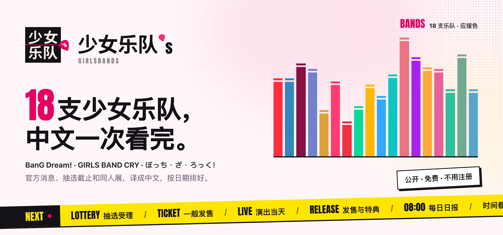
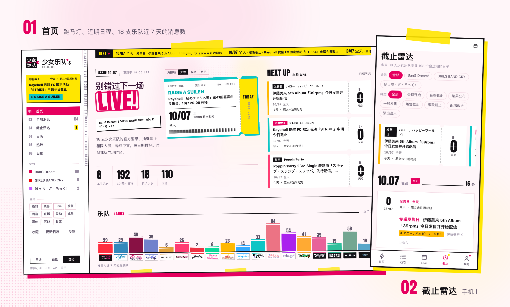
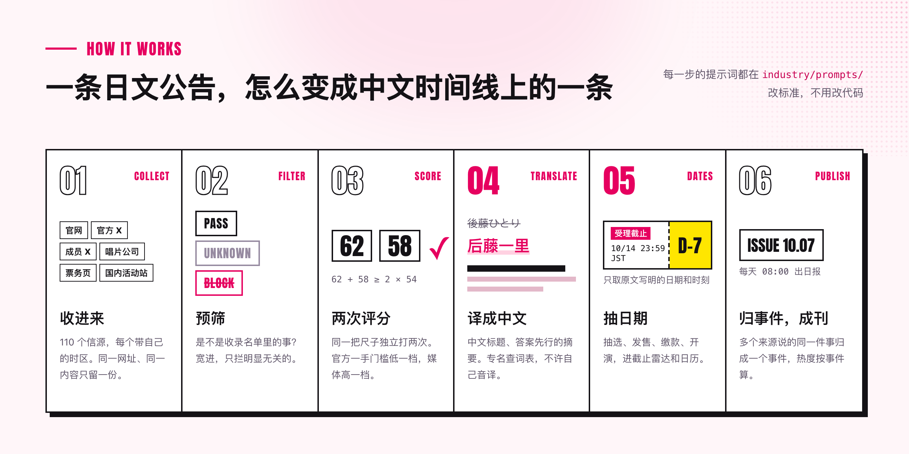
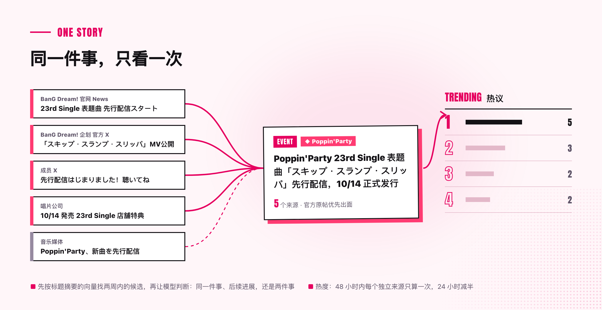
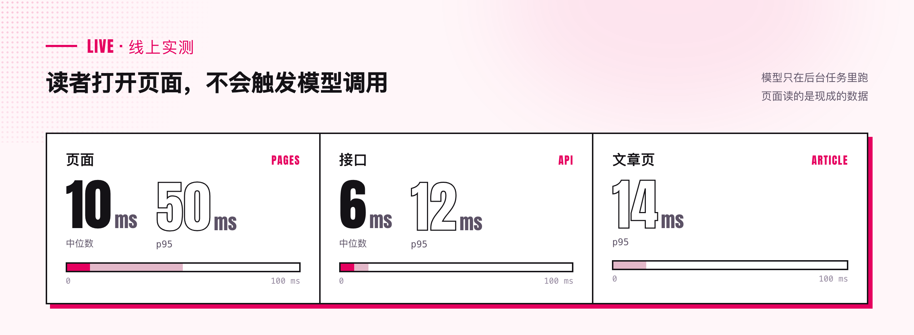

<picture>
  <source media="(prefers-color-scheme: dark)" srcset="docs/assets/banner-dark.png">
  
</picture>

<p align="center">
  <b>BanG Dream! · GIRLS BAND CRY · ぼっち・ざ・ろっく，中文一次看完。</b><br>
  官网、官方 X、唱片公司、票务页各发各的日文公告，这里收成一条中文时间线；国内的邦O、刺O 和 livehouse 演出也在。
</p>

<p align="center">
  <a href="https://girlsbands.com"><b>girlsbands.com</b></a> ·
  <a href="https://girlsbands.com/deadlines">截止雷达</a> ·
  <a href="https://girlsbands.com/calendar">日历</a> ·
  <a href="https://girlsbands.com/daily">日报</a> ·
  <a href="https://girlsbands.com/agent">Agent 接入</a>
</p>

<p align="center">
  <a href="LICENSE"></a>
  
  
  
</p>

<br>

<picture>
  <source media="(prefers-color-scheme: dark)" srcset="docs/assets/shots-dark.png">
  
</picture>

## 为什么有这个站

一场 Live 从公布到开演，会拆成十几次公告：先行抽选、一般发售、追加席、开场时间调整、周边、当日券……分散在官网、官方 X、唱片公司和票务页上，全是日文，错过一条就可能错过一轮抽选。

少女乐队's 每天替你盯着这一百多个信源，把它们翻成中文、合并重复、按事件串起来，把快到期的节点单独挑出来。**公开、免费、不用注册**。

覆盖范围是名单制：三个企划（BanG Dream!、GIRLS BAND CRY、ぼっち・ざ・ろっく）和旗下 18 支乐队，加上国内的同人 Only 活动与 livehouse 演出。

## 读者能用它做什么

| | |
|---|---|
| **看动态** | 精选、全部动态、热点榜。每条都有中文标题和答案先行的摘要；官方一手的公告整篇翻成中文，第三方媒体只给中文摘要和原文链接。官方号和成员号的推文按 X 的样式显示 |
| **别错过截止** | [截止雷达](https://girlsbands.com/deadlines) 列出 30 天内的抽选、发售、缴款节点，首页只放 14 天内能动手的。日期只取原文写明的，不替官方推算 |
| **排日程** | 每个企划一张月历，另给 `.ics` 订阅地址导进手机日历；时刻按公告所在地的钟写（「19:00 日本时间」），不换算 |
| **跟一场 Live** | Live 页把公布、各轮票务、变更和事后的 Setlist 挂在一起；官方改了开演时间、场馆、票价或出演者，会醒目地标出「相比上一版变了什么」 |
| **查一张碟** | 发售页列出版本、店铺特典、封入抽选券对应哪一场 |
| **按乐队、按成员看** | 每个企划和每支乐队一页（企划页收整个系列），带近 12 个月的大事记；成员页分清角色、CV 与乐手 |
| **读日报周报月报** | 每天 08:00 出日报，一件事一条，报过的事只在有新进展时跟进；周一出周报、每月 1 日出月报 |
| **收藏与提醒** | 收藏存在浏览器里，不用账号；想要邮件就按乐队订阅：抽选与发售截止前提醒，每晚一封精选摘要，双重确认、一键退订 |
| **纠错与投稿** | 日期错了、漏了一条，在 [反馈](https://girlsbands.com/feedback) 或 [投稿](https://girlsbands.com/submit) 直接说 |
| **远征** | [远征攻略](https://girlsbands.com/guide) 不重写别人的攻略，只指向写得最好的公开资料，再接回站内的截止雷达和日历 |

网站可以添加到手机主屏幕当 App 用，深浅色跟随系统。

## 给 Agent 和工具用

同一份内容，人看的和机器读的出自同一个读取层：

- **RSS**：精选、全部、日报、周报、月报
- **公开 API**：`/api/v1/`，契约在 `/openapi-v1.json`
- **Agent Markdown**：只会读网页的 Agent 从 `/api/v1/agent` 开始，那里列出精选、搜索、热点、事件和各期报告的 Markdown 地址
- **MCP** 与 `llms.txt`

在站上打开 [`/agent`](https://girlsbands.com/agent) 可以直接复制接入方式。

## 它是怎么工作的

<picture>
  <source media="(prefers-color-scheme: dark)" srcset="docs/assets/how-dark.png">
  
</picture>

一条资料从信源进来，先判重，再预筛；可能重要的独立打两次分，写好中文标题和摘要，和别的报道聚成事件，算进热度。分数过门槛、又不是已有新闻的重复，才进精选。每一步的提示词都在 [`industry/prompts/`](industry/prompts/)，改标准不用改代码。详见 [精选与校准](docs/selection.md)。

**中文怎么保证。** 专名走一份受控词表（[`industry/glossary.ts`](industry/glossary.ts)）：原文里出现了哪些乐队、成员、会场，就把对应的几种写法列给模型，让它在里面挑——中文圈有通用名的用通用名（後藤ひとり → 后藤一里），没有的照抄原文，不许自己音译。写作步骤没给出中文标题和摘要的不上站，换一次再问，仍然没有就标成失败。后台每周抽 20 条左右对照原文人工检查，翻译失败率和耗时另有告警。

**同一件事只看一次。** 官网发一篇、媒体转十篇、X 上吵一天，会被聚成一个**事件**：先在最近两周里按标题摘要的向量找候选，再让模型判断是同一件事、后续进展，还是两件事；拿不准的换一家模型复核。

<picture>
  <source media="(prefers-color-scheme: dark)" srcset="docs/assets/cluster-dark.png">
  
</picture>

**热度按事件算，不按文章算。** 48 小时内每个独立来源只算一次，24 小时减半；一家媒体发十篇也只算一次，所以排在前面的是真正很多人在说的事。

**读者打开页面不会触发模型调用。** 模型只在后台任务里跑，页面是现成的数据：

<picture>
  <source media="(prefers-color-scheme: dark)" srcset="docs/assets/perf-dark.png">
  
</picture>

## 版权与下架

原文和演出信息的版权归各来源所有，一切以官方公告为准。展示方式按来源分层：官方一手与明确许可的来源放中文全文，第三方媒体只给标题、中文摘要和原文链接，规则写在 [`/rights`](https://girlsbands.com/rights)。

如果你是来源方，希望更正、下架或调整展示方式，写信到 contact@girlsbands.com。单条和整个来源都能在后台当场下架，所有出口（网页、RSS、API、MCP）同时生效。

## 自己跑一份

需要 [Docker](https://docs.docker.com/get-docker/) 和一个 OpenAI 兼容的模型 API Key（DeepSeek、千问、智谱都可以）。

```bash
git clone https://github.com/RinneBeat/girlsbands.git
cd girlsbands
node scripts/init-env.ts --llm-key <你的模型 API Key>
docker compose up -d --build
```

打开 <http://localhost:3000>。后台在 `/admin`，管理员密码在 `.env` 的 `ADMIN_PASSWORD` 里。新生成的 `.env` 里所有对外的开关都是关的：站点能打开、后台能登录，但不抓信源、不调模型、不发邮件。看过一遍后把 `COLLECT_ENABLED`、`MODEL_CALLS_ENABLED` 改成 `true`，再 `docker compose up -d api worker`，一两分钟后开始有内容。

机器上没有 Node、服务器在中国大陆、要配域名和 HTTPS，见 [部署](docs/deploy.md)。

### 改成别的企划或别的行业

和“少女乐队”有关的一切都在 [`industry/`](industry/) 这一个文件夹里，通常不需要改 `apps/` 和 `packages/`：

| 文件 | 管什么 |
|---|---|
| `site.ts` | 站名、首页文案、关于页、联系邮箱 |
| `taxonomy.ts`、`topics.json` | 分类、标签、企划与乐队、谁属于哪个系列 |
| `glossary*.ts` | 受控词表：企划、乐队、成员、会场的写法 |
| `chronicle.ts` | 乐队页“大事记”的规则 |
| `sources.json` | 首次启动时导入的信源（含每个源的时区） |
| `prompts/` | 预筛、评分、写作、结构化、归组、翻译的提示词。**行业 KnowHow 就写在这里** |
| `selection.ts` | 入选门槛 |
| `brand/`、`pages/`、`email/` | 图标与报头字、条款与隐私说明、邮件外观 |

最值得花时间的是评分标准（`prompts/selection-score.md`）和门槛：拿一两百条自己标注过的资料，用 `scripts/eval-selection.ts` 跑一遍，看它选得准不准，再回去改。换行业的完整顺序见 [配置与改造](docs/customize.md)。

### 改代码之前

先读 [架构](docs/architecture.md)，界面上的一切按 [设计规范](docs/design.md) 来。改完至少跑：

```bash
npm run typecheck
DATABASE_URL=postgres://127.0.0.1:5432/girlsbands_test npm test   # 库名必须以 _test 或 _ci 结尾
npm run build -w @girlsbands/web && node --test apps/web/tests/*.test.ts
```

技术栈：Node.js 24（直接跑 TypeScript）· React Router（服务端渲染）· Fastify · PostgreSQL · pg-boss · Tailwind CSS · Docker Compose。

## 文档

| 文档 | 内容 |
|---|---|
| [配置与改造](docs/customize.md) | 站名、分类、主题与大事记、信源、提示词、门槛、品牌，一步一步来 |
| [信源](docs/sources.md) | 几种信源怎么配，分级、时区与全文，外部推送接口 |
| [精选与校准](docs/selection.md) | 一条资料怎么变成精选、怎么编进日报周报月报，怎么用自己的样本校准 |
| [事件归组与关系评测](docs/grouping.md) | 事件关系怎么判断，怎么用自己的 pairwise gold set 评测 |
| [邮件订阅](docs/subscribe.md) | 截止提醒与精选摘要怎么发、SMTP 怎么配、邮件外观、退订与合规 |
| [部署](docs/deploy.md) | Docker、域名和 HTTPS、中国大陆、更新、备份、花多少钱 |
| [上线检查单](docs/launch-checklist.md) | 上线前逐项核对：已经验过的、站主要拍板的、开开关的顺序 |
| [架构](docs/architecture.md) | 三个进程、几条不变的规则、目录、对外出口 |
| [设计规范](docs/design.md) | STAGE FLYER：网站、邮件、分享图共用的视觉语言 |
| [改造计划](docs/refit-plan.md) | 从 AIHOT 改成这个站的全过程，每一批做了什么、为什么 |

## 反馈与贡献

读者反馈走站内的 [反馈](https://girlsbands.com/feedback)。代码上的 Bug 或明确的功能建议，[提交 Issue](https://github.com/RinneBeat/girlsbands/issues/new/choose)；准备改代码前先看 [贡献说明](CONTRIBUTING.md)；安全漏洞请走 [私密报告入口](SECURITY.md)。

## 许可

代码使用 [MIT 许可证](LICENSE)。本站基于 AIHOT 框架改造，上游版权与商标归属见 [NOTICE](NOTICE)。字体与其它第三方标志各有自己的许可和商标归属，同样见 [NOTICE](NOTICE)。
